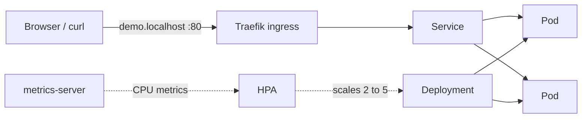

# k8s-helm-demo

A small Flask app packaged as a Docker image and deployed to a local Kubernetes
cluster (kind) with a custom Helm chart. It includes an Ingress, health probes,
resource limits and CPU-based autoscaling.

## What this project shows

- Containerizing an app with Docker (non-root user, pinned dependencies)
- Running a local Kubernetes cluster with kind
- Writing a Helm chart: Deployment, Service, Ingress and HorizontalPodAutoscaler
- Readiness and liveness probes against a `/health` endpoint
- Routing traffic through the Traefik ingress controller
- Autoscaling from 2 to 5 replicas with metrics-server

## Architecture



## Project structure

```
.
├── app.py                 # Flask app with / and /health endpoints
├── Dockerfile             # Container image
├── requirements.txt
├── kind-config.yaml       # kind cluster with ports 80/443 mapped to localhost
└── charts/demo-app/       # Helm chart
    ├── Chart.yaml
    ├── values.yaml
    └── templates/         # deployment, service, ingress, hpa
```

## Prerequisites

Docker Desktop, kind, kubectl and Helm.

## Run it locally

```bash
# 1. Build the image
docker build -t demo-app:0.1.0 .

# 2. Create the cluster and load the image into it
kind create cluster --name demo --config kind-config.yaml
kind load docker-image demo-app:0.1.0 --name demo

# 3. Install the Traefik ingress controller
helm repo add traefik https://traefik.github.io/charts
helm repo update
helm upgrade --install traefik traefik/traefik --namespace traefik --create-namespace \
  --set ports.web.hostPort=80 --set ports.websecure.hostPort=443

# 4. Install metrics-server (needed for autoscaling)
helm repo add metrics-server https://kubernetes-sigs.github.io/metrics-server/
helm upgrade --install metrics-server metrics-server/metrics-server --namespace kube-system \
  --set "args={--kubelet-insecure-tls}"

# 5. Deploy the app
helm upgrade --install demo charts/demo-app --wait

# 6. Test it
curl -H "Host: demo.localhost" http://localhost/
curl -H "Host: demo.localhost" http://localhost/health
```

On Windows PowerShell, use `curl.exe` instead of `curl`.


Run the first `curl` several times. The `pod` value changes as traffic is shared
across replicas.


## Autoscaling demo

```bash
kubectl get hpa demo-demo-app -w
kubectl run load --image=busybox:1.36 --restart=Never -- /bin/sh -c \
  "while true; do wget -q -O- http://demo-demo-app/ > /dev/null; done"
```

When average CPU passes 70%, the HPA adds replicas, up to 5.
Stop the load with `kubectl delete pod load`.


## Clean up

```bash
kind delete cluster --name demo
```

## Notes

- `--kubelet-insecure-tls` on metrics-server is only for local kind clusters.
  Do not use it in production.
- Traefik is used as the ingress controller because the community ingress-nginx
  controller has been retired.
- Image tag `0.1.0` is loaded directly into kind, so no registry is needed.

## Possible improvements

- GitHub Actions pipeline for `helm lint` and image builds
- Push the image to a container registry (for example Azure Container Registry)
- Deploy the same chart to AKS (see my Terraform AKS platform project)